# RXF — Reversible eXecutable Format

RXF treats a program as a **complete, self-describing object world**, not a one-way
compilation product. Types, modules, functions, calls, values, ownership, semantic graphs,
target descriptions, ABI contracts, and live data are ordinary addressable objects in one
binary image.

The same image can be:

- authored and stored as XML deltas, one file per module (paths and field values, no IDs);
- minted deterministically into one binary image and written back out unchanged;
- inspected as an object tree with fields, references, and who uses what; and
- digested twice: the image (compacted bytes) and the canonical text.

The direction (see [the operating-system path](docs/17-OPERATING-SYSTEM-PATH.md)) is native
Code for several architectures inside the same image, and executable wrappers that keep
**RXF as the program** — not a stripped binary with a metadata copy next to it.

## What you can build with RXF

Conventional executable formats keep enough to load the code and lose the authored
structure. RXF is for systems where a running or bootable artifact must stay
**explainable, transformable, movable, and certifiable**.

- **Artifacts that stay explainable** — open any image in [the inspector](#the-inspector-read-the-object-world):
  the object tree, the arena as a map, and who points at whom.
- **Live systems you can edit while they run** — [the console](#the-console-a-terminal-on-a-running-image)
  and [the editor](#the-editor-source-in-one-delta-out) compile and install one delta into a
  running image. No restart.
- **Deterministic, certifiable builds** — the same deltas mint the same bytes; digests pin
  the image and the canonical text.
- **C, C++, and Rust in the same world** — `tools/native/rximport.py` lowers source (or a raw
  `.ll`, read as it stands) onto the same semantic graphs and refuses by name what it cannot
  take.
- **MicroPython guests on the image's own module tree** — `import` walks the cells: one
  storage, no filesystem, no second copy.

## Quickstart

```sh
python -m venv .venv
.venv/bin/pip install scikit-build-core nanobind setuptools-scm
.venv/bin/pip install -e ".[test,server]" --no-build-isolation

.venv/bin/python -m pytest tests          # the suite
.venv/bin/rxf core object info starter    # read the default image
.venv/bin/rxf server browse starter       # the inspector on http://127.0.0.1:8420
.venv/bin/rxf console                     # a terminal on a running image
```

Requires Python 3.12+. The `rxf` commands throughout this README assume `.venv/bin` on your
`PATH`; otherwise prefix them with `.venv/bin/`.

## Features

### The web app: one shell, five surfaces

`rxf server serve` runs one web app on a real running image — the app and the image behind it
share one link, and `rxf console --link=…` attaches to the same one. Inspector reads, Model
explains, Editor edits, Tutor teaches, World renders: one nav, one shell, and the shell's
live slot is the one live feed — `no image` while no image runs, then what the running image
itself answers.

```sh
rxf server serve starter --link=shm:rxf   # the app and a running image of the starter tree
```

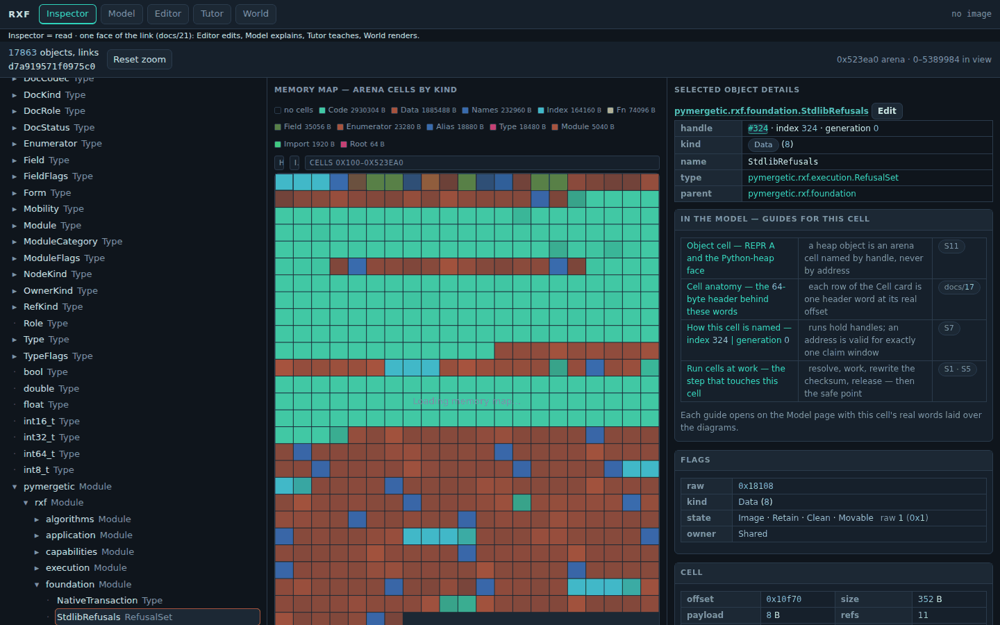

### The inspector: read the object world

`rxf server browse starter` serves a read-only inspector: the object tree on the left, the
arena as a clickable memory map in the middle, full cell introspection on the right — flags,
fields, a payload hex dump with reference slots highlighted, and who points at the object.
Every detail opens with an **In the model** card that deep-links into the model page.


### The model page: the run-cell machine

`/model` documents the run-cell machine inside the tool: six sections, each with its own
figure, every fact citing its section of [the execution policy](docs/20-EXECUTION-POLICY.md).
The pin chips carry real numbers — 41 constants read out of the C and pinned by
`tests/test_model_doc.py`, so a constant that moves fails the test until the page follows.
Follow a cell's **In the model** link and its real header words are laid over the anatomy
figure, with a link back to the cell.

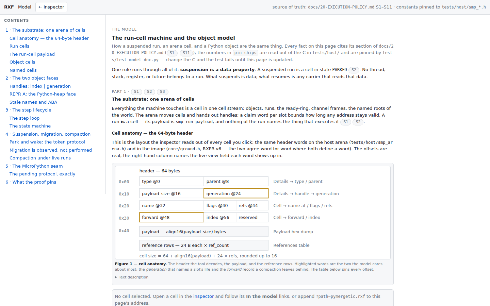

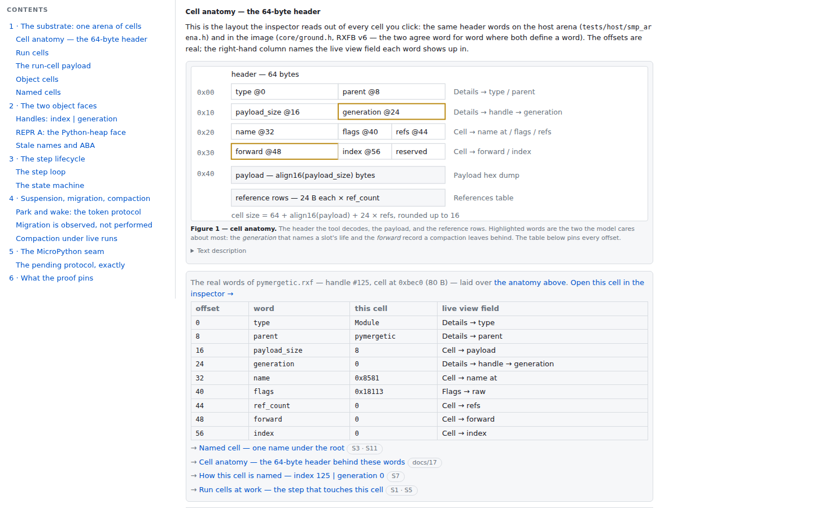

### The editor: source in, one delta out

The editor compiles a function's source through the running image's own front end and
installs it as **one** delta — the delta is shown before it is sent. Tokens are marked
red/green as you type, and a refusal carries its reason. The read-only faces (Pseudo, C,
C++, Python) refuse to fake a body they cannot know; cell-poke writes `payload`/`flags` and
refuses `forward`/`generation`/`checksum` and `name` outright.

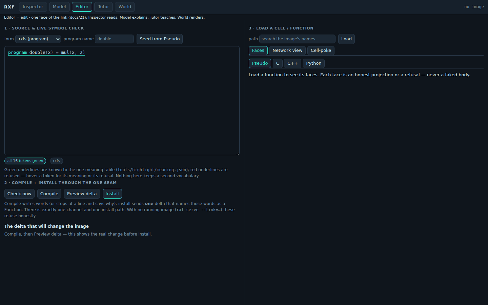

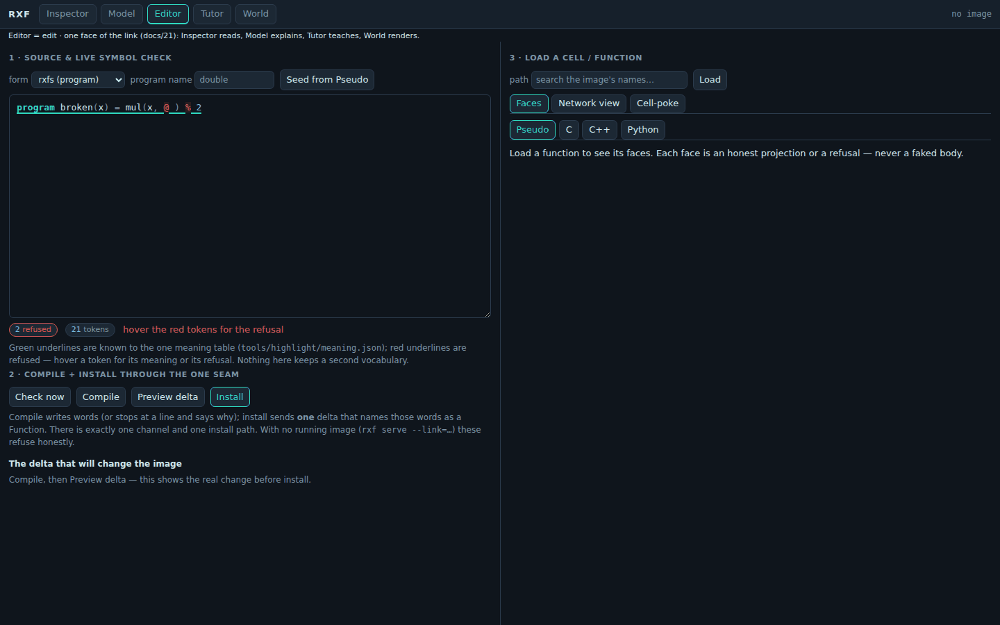

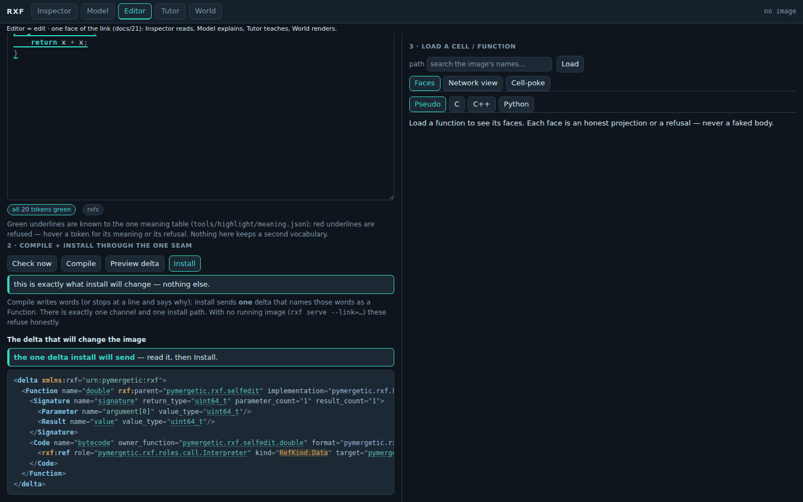

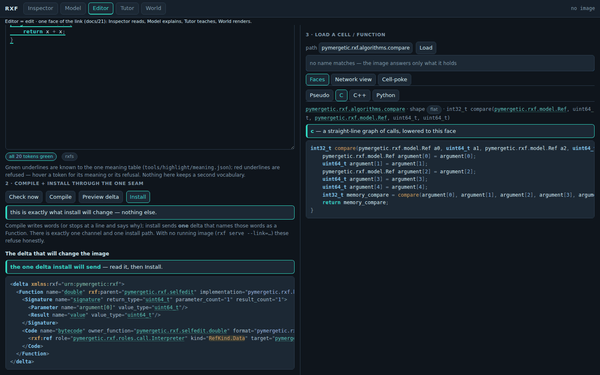

### The console: a terminal on a running image

Type `.rxfs`; the program ends at a blank line (or a line of one `.`), travels as one object
of the arena through the channel, and the image's own front end compiles it and installs the
Function — one delta, no restart.

```sh
rxf console --link=shm:rxf
rxf> program triple(x) {
...     return x + x + x;
...
installed pymergetic.rxf.selfedit.triple (id 0x4e1a69dd971cf5a3, 328 bytes)
rxf> :quit
```

`--link` is wherever the image runs (`shm:name`, `pty:/dev/pts/3`, `tty:/dev/ttyUSB0`,
`fd:3`); `rxf console FILE` takes one source file through the same path once, `--inspect`
lists what the image has installed. Whoever runs the image registers its machine in the one
registry (`pymergetic.rxftk.console.world`) — one link, one runner; a second world at the same
link is refused (`WorldIsRegistered`), not stolen, and shutdown takes the registration with
it.

### The 3D world: the image as an RTS city

The world view draws the checked-in demo world over the same cells the inspector reads:
cells are block-stack buildings, references are street cables between the lots, and the
ready-ring is the boulevard where the run cells ride. WASD moves camera-relative; the
minimap is a real top-down projection of the same document.

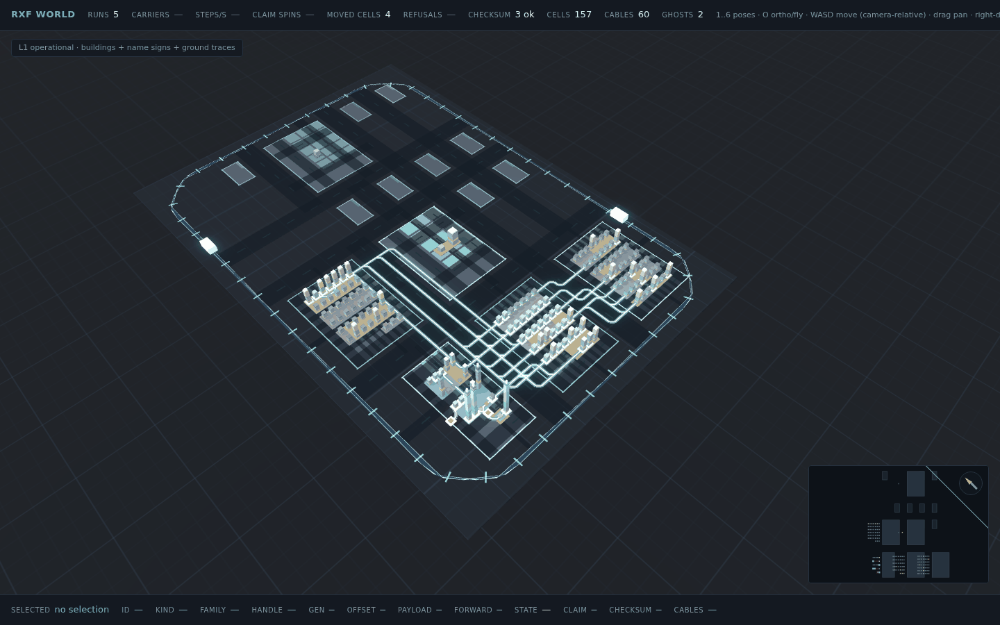

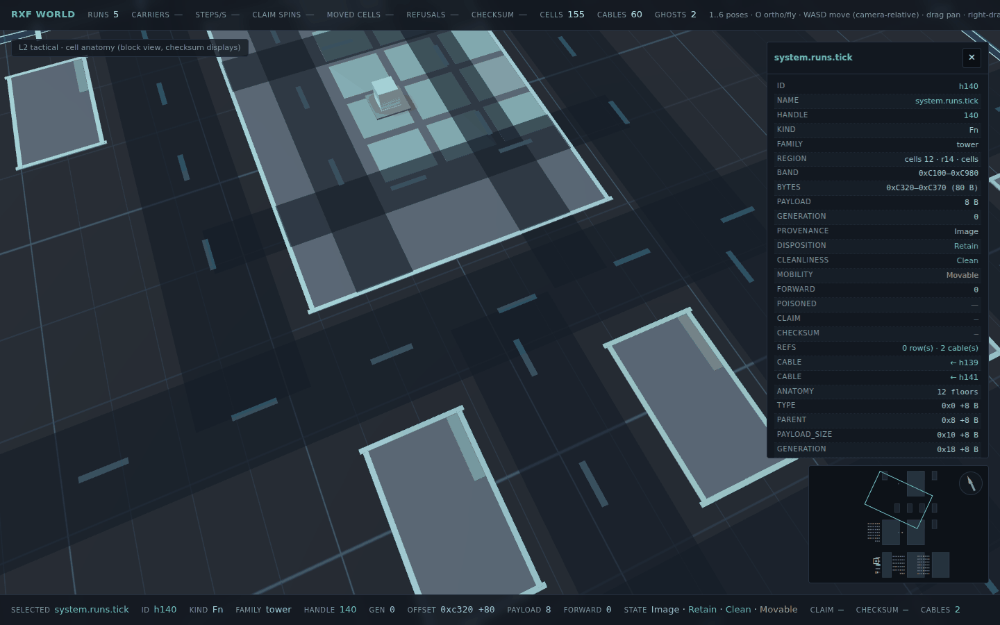

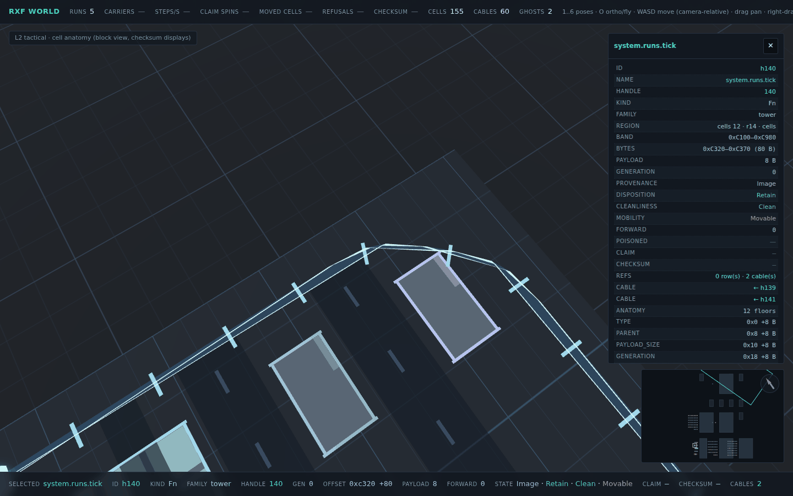

Click a building and the image answers: the HUD's cell fields fill along the bottom, and the
datasheet opens beside the scene — `IMAGE — read from the cell` above `WORLD — the view's own
reading`.

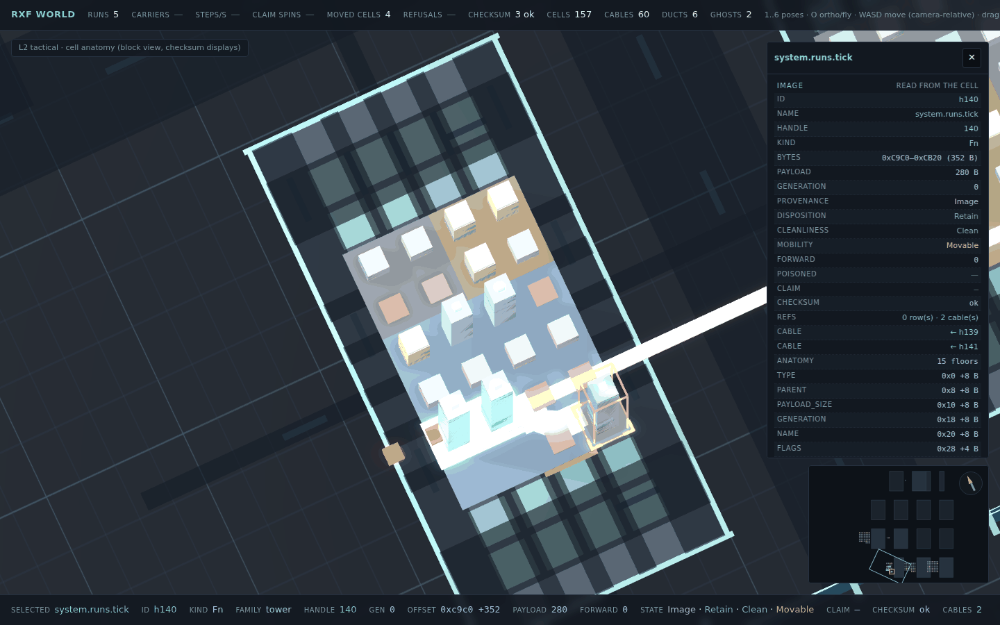

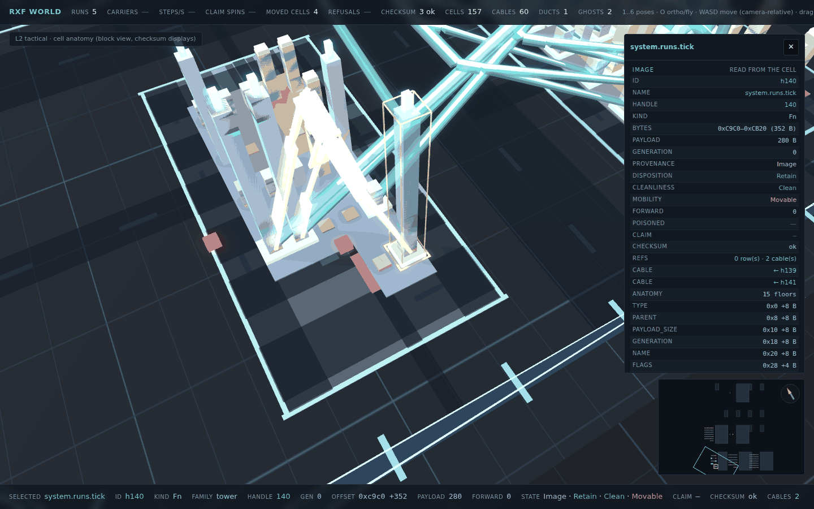

The scene draws `demo_world.rxfd` plus the traces a running snapshot carries (a stale
handle's ghost cables, the `0xA5` poison of compaction), exported to `demo-scene.json` as a
byte-exact golden the tests pin — no randomness behind any frame. At the extreme angles the
text stays readable: name labels and checksums hold at pitch 90 and pitch 68.

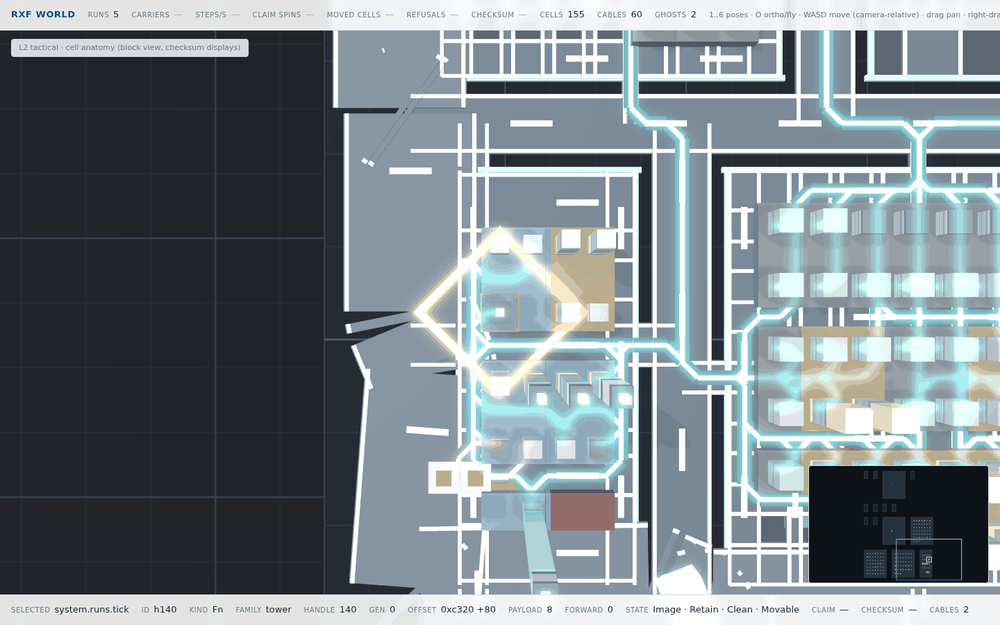

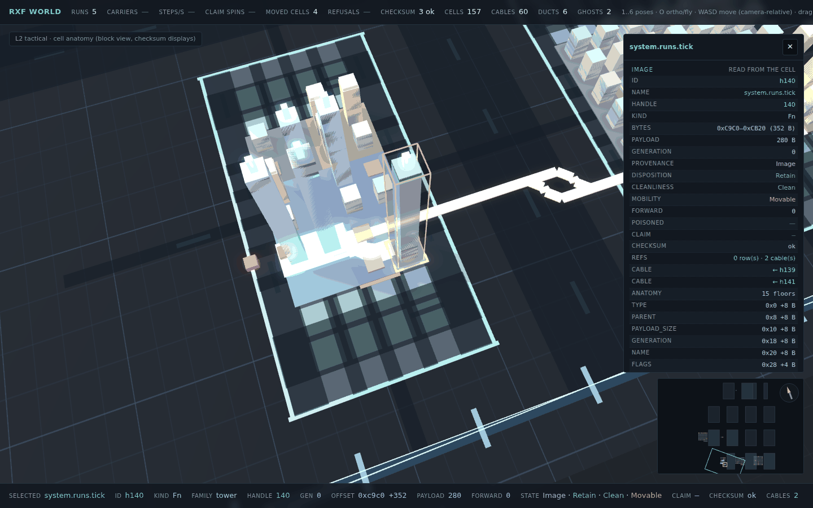

### The module tree: one XML file per module

The default image is checked in as `starter/`, one XML file per module, laid out like Python
modules:

```
starter/__init__.rxfd                         the types and the entry
starter/pymergetic/__init__.rxfd              module pymergetic
starter/pymergetic/rxf/__init__.rxfd          module pymergetic.rxf
starter/pymergetic/rxf/kinds.rxfd            the enumerations of the data (AbiKind, Effects, ...)
starter/pymergetic/rxf/foundation/heap.rxfd  module pymergetic.rxf.foundation.heap
starter/pymergetic/rxf/roles/call.rxfd       module pymergetic.rxf.roles.call
```

```xml
<ABIValueLocation name="output" rxf:index="2" association="@heap.allocate.signature.value" ...>
  <rxf:ref role="@contract.IndirectPointee" kind="RefKind.Type" target="uint64_t" />
</ABIValueLocation>
```

Everything the format says about itself is in the `rxf` XML namespace: an edge is said once
(a field is the reference, the children are the list, the other direction is computed),
roles are objects named by path, order among siblings is `rxf:index`, the n-th element of a
list is `name[n]`, a word is the path of its enumerator and never a bare word, and Types and
roles are CamelCase, modules and fields snake_case. See
[deltas and their XML form](docs/15-DELTAS-AND-XML.md).

The same named cells read back as the image's **module tree** — `rximport` compiles modules
into it and MicroPython reads it back: one storage, no filesystem, no second copy. A module
is a named cell under one of the Quad roots (`px` extern/cpython, `pm` mpy, `pt`
thirdparty, `py` micro), and `Image.resolve_module` answers exactly the trichotomy
`mp_import_stat` gives. `Image.module_children` lists a package's sub-modules in name order,
`Image.module_roots` answers the four roots and nothing else, and a name that does not spell
one clear module raises `TreeError` instead of guessing.

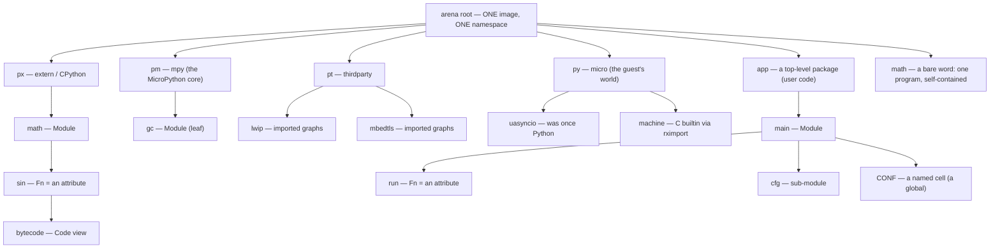

A guest `import app.cfg` walks it as the trichotomy:

```
mp_import_stat("app")      → package   → keep walking
mp_import_stat("app.cfg")  → module    → the cell is found
app.cfg.CONF               → no import: an attribute read of the named cell CONF
app.main.run               → none: a Fn is an attribute of its module, never a module name
```

### The mount: the object world as Python

`pymergetic.rxftk.mount` mounts one image and `import` answers from it — the same
trichotomy and the same objects the guest reads. What a Type object describes becomes a
Python class whose properties read the cell at the field's offset (no dicts, no parsing);
what a Module cell names becomes the module. The host wins where it has the name: the
finder sits last in `sys.meta_path`.

```python
from pymergetic.rxftk import mount

image = mount.image_open("starter")          # .rxfb bytes or a .rxfd tree

import pymergetic.rxf.library.heap as heap   # the image answers the name
dir(heap)                                    # what the module exports
run = pymergetic.rxf.foundation.graph.run    # one face per object, named or imported
run.implementations                          # a declared relation is a list of faces
run.target                                   # a payload leaf read at its offset
type(run).__name__                           # 'Function' — the class of its Type object
```

Open, import, inspect, call: the mount is read-only (edits are deltas,
[docs/27](docs/27-EDITING.md)); one image at a time. The MicroPython guest needs no
finder at all — it boots into this same object world
([the self-description](docs/16-SELF-DESCRIPTION.md) makes the faces).

### The command line

`rxf` is one Python Fire entry point. A command lives next to what it operates on and its
path is the module path: `core/object/cli.py` defines `rxf core object ...`,
`server/cli.py` defines `rxf server ...`. A new `cli.py` is a new command group. `rxf`
alone lists every command.

```sh
rxf core object info   starter                 # objects, entry, digests, problems
rxf core object check  starter                 # link check, exit status 1 on problems
rxf core object digest starter                 # image digest and delta digest
rxf core object save   starter starter.rxfb    # .rxfd one delta, .rxfb bytes, else a module tree
rxf core delta show    starter --module=pymergetic.rxf.roles
rxf core delta apply   starter patch.rxfd --to=out.rxfb
rxf server browse      starter                 # read-only inspector on http://127.0.0.1:8420
rxf console                                    # type .rxfs; the running image compiles it
rxf console  program.rxfs                       # one source file through the same path, once
rxf console  --inspect                         # what the image has installed (read-only)
```

A source is a module tree (directory), a `.rxfd` delta, or RXFB 6 bytes.

### Editor support: `.rxfs` and `.rxfd`

`editors/rxf-highlight/` is a dependency-free Cursor/VS Code extension with TextMate
grammars for the two text forms: `.rxfs`, the program language `tools/native/rxfc.py`
compiles, and `.rxfd`, the delta documents. The grammars are generated bytes from one
meaning table (`tools/highlight/meaning.json`), never edited by hand; `tests/test_highlight.py`
pins the table back to `graph.h`, `rxfc.py`, and `words.rxfs`, and the checked-in grammars are
proven to be the generated ones (`python3 -m tools.highlight.grammar_gen --check`).

```sh
ln -s "$PWD/editors/rxf-highlight" ~/.cursor/extensions/pymergetic.rxf-highlight-0.1.0   # Cursor
ln -s "$PWD/editors/rxf-highlight" ~/.vscode/extensions/pymergetic.rxf-highlight-0.1.0   # VS Code
```

## Status

RXF is a new version: a C++ core on one arena, with Python as orchestration (nanobind).

**In the tree today.**

- the ground layout (`src/pymergetic/rxftk/core/ground.h`) pinned for x86-64, AArch64, i386,
  and wasm32 in C11 and C++20;
- the arena and the host image (paths, names, roles, canonical copying compaction) and the
  self-description (`Type` and `Field` objects read by one generic codec);
- deltas as XML ([pugixml](https://pugixml.org)) with atomic replay on a journal, a link
  check, and SHA-256 digests;
- a **live layer** that lets a running image be read and edited from outside: CRC-framed
  channel, physical delta, compaction and relink in the image, safe points and break, UART,
  shared-memory and pty providers, `rxf live`;
- a compiler leaf for every program (machine code on three machines), and the in-image
  composer (`native/compose`) writing program words byte-identical to the host composer
  (`tools/native/compose.py`) for all 58 programs of the corpus (53 graphs, 5 expressions);
- the **execution policy** ([20](docs/20-EXECUTION-POLICY.md)): suspension is a data
  property, proven by the host SMP harness (`tests/host/`);
- the dispatch and out-cell flips (`mp_obj_is_true`, `mp_obj_get_int_maybe` — the last two
  MicroPython refusals) lowering as slot dispatch and an out-cell;
- an **import lane** (`tools/native/rximport.py`) that lowers C, C++ and Rust source — or a
  raw `.ll`, read as it stands — onto the same semantic graphs and refuses by name what is
  outside its subset, `rximport --provenance` carrying the run's origin record, a citation
  per file (`path`, the line span, `sha256`) and every comment it lifts;
- an image as a **module tree**, one XML file per module (`starter/`), read back through the
  hybrid module tree (`Image.resolve_module`, `module_children`, `module_roots`);
- the `rxf` command line (Python Fire, command path = module path), syntax highlighting for
  the two text forms (`.rxfs`, `.rxfd`) generated from one meaning table
  (`editors/rxf-highlight`), a read-only inspector with an arena memory map, cell
  introspection, and a model page, the **web app** over the same image (one shell on five
  surfaces, `/tutor` stepping the run-cell machine by hand, the live feed in the shell's live
  slot, and the editor's compile, install, poke and name search), and the 3D world view; and
- the build (CMake, scikit-build-core, nanobind 3, platform wheels through cibuildwheel).

**Under construction.** The last rung of the **self-editing path**
([19](docs/19-SELF-EDITING-PATH.md)): the compiler written as a semantic graph and
the semantic-graph checks and passes
([05](docs/05-SEMANTIC-AUTHORITY.md), [07](docs/07-SUCCESSOR-AND-ACTIVATION.md)).
Everything below it is present — the running image compiles its own front end and
composer from source, installs the compiler from a delta, and proves the fixpoint on
x86-64, AArch64, and wasm32.

**Built since.** Executable packaging (ELF, PE/COFF, BIOS, UEFI — QEMU boots both
firmware images, [`tests/test_boot_qemu.py`](tests/test_boot_qemu.py)) and certification
(Ed25519 statements, M-of-N quorum, the activation gates the build,
[`tests/test_binary_activation.py`](tests/test_binary_activation.py)) are no longer
designs. What remains before the package leaves `0.x`: resource limits in the trust
policy (the slot exists, enforcement does not), and measured boot in the firmware
([what is missing](docs/08-INVENTORY.md), [17](docs/17-OPERATING-SYSTEM-PATH.md)). The
former v5 Python stack's last state is the git tag `legacy-v5-python`.

## The format

### RXFB 6 binary model

An image is one arena: a 192-byte header, an index directory, and a cell stream. Object
cells have a 64-byte header, the payload padded to 16 bytes, and 24-byte references (target,
role, kind, binding, index); block cells carry the index chunks (4096 slots of 8 bytes) and
the names. Identities, addresses, offsets, and sizes are 64-bit. The layout is defined once
as C structs in `src/pymergetic/rxftk/core/ground.h`, with the size and offset of every field
pinned by static assertions. See [the arena and allocator state](docs/03-ALLOCATOR-STATE.md).

### Names and formats

"RXF" names several different things; the file suffixes and the words below keep them apart.

| Name | What it is | Form |
|---|---|---|
| **`.rxfs`** | the **source language** compiled by `tools/native/rxfc.py`: statements, `proc`/`macro`/`fn`, every operator one leaf call. The files in `native/tiny/`, `native/front/`, `tests/rxfc/` are this. | text |
| **`.rxfb`** | an **RXFB 6 image**: one arena (header, index directory, cell stream). `starter.rxfb`, `rxf binary check`. | binary |
| **`.rxfd`** | a **delta**, the storage and exchange form; one per module in the module tree. | text |
| **program words** | what `rxfc.py` compiles a `.rxfs` source into: a header and a sequence of 64-bit instructions (`native/graph.h`), run by the interpreter and turned into machine code by leaf 31 or `tiny.compile`. | binary, stored as a `Bytecode` object in the image |

So `.rxfs` is always source text and `.rxfb` is always an image; they differ by one letter.
The compiled form of a `.rxfs` program is **not a file**: it is bytes that live inside an RXFB
6 image (for example `tiny.compile` in `starter/…/foundation/tiny.rxfd`), never a `.rxfs` file.
The front end of the language (`native/front`) reads `.rxfs` source and writes those program
words inside a running image — the image compiles its own front end and the successor
replaces it from a delta; `rxfc.py` is the same compiler on the host.

### Core invariants

([The operating-system path](docs/17-OPERATING-SYSTEM-PATH.md), [the object model](docs/01-OBJECT-MODEL.md).)

- the identity of an object is its path, unique per parent; handles are image-local `uint64` slots and never appear in a delta;
- the root, `Type`, and `Field` have the fixed handles 0, 1, and 2; every other object is found by path;
- one arena: an arena header, an index directory, and one cell stream (64-byte cell headers with inline 24-byte references, plus block cells for the index chunks and the names);
- everything with identity is an object, and `Type` and `Field` describe themselves; so is a reference's **role** (an object named by path, never a number);
- no DOMAIN semantic objects, arenas, regions, or per-domain heaps;
- ownership is a kind in the cell flags plus an optional `OWNER` reference, separate from lifecycle state;
- lifecycle is provenance × disposition × cleanliness × mobility;
- pages are allocator geometry and policy, not semantic objects;
- unknown limits never extend committed write authority; and
- deltas (XML) are the storage and exchange format, and successors are produced by deterministic, non-mutating copying compaction in path order.

## For contributors

### How the repo is organized

```
src/pymergetic/rxftk/
  cli.py  source.py            the entry point and image I/O
  binary/                      commands on the RXFB 6 bytes (`rxf binary …`)
  core/                        the compiled package pymergetic.rxftk.core
    arena/ object/ hash/ meta/ delta/ xml/ tree/    C++ modules, each with bindings.cpp and, where it has one, cli.py
    *.pyi                      generated stubs, one per Python submodule
  console/                     the console on a running image (`rxf console`) and the world seam
  live/                        the live channel: client, front end, and the commands of `rxf live`
  memory/                      linked AI memories as graph cells (docs/24)
  net/                         devices, sockets, filters, transports (docs/25)
  server/                      the web app: the inspector, the model page, the editor, the tutor
  world/                       the 3D world view: the demo world, the exporter, and the scene
```

Around it: `starter/` is the checked-in default image (the module tree above), `tests/` the
suite with `tests/host/` the C harness behind the SMP proofs, `tools/native/` the host
compilers (`rxfc.py`, `compose.py`, `rximport.py`), `editors/` the editor extensions, and
`docs/` the specification.

### Gates

```sh
.venv/bin/python -m pytest       # the suite
~/.local/bin/ruff check          # lint
~/.local/bin/pyright             # types
```

Deeper checks for changes that touch what they cover:

```sh
.venv/bin/python tools/sanitize.py                   # core tests under AddressSanitizer and UBSan
.venv/bin/python -m nanobind.stubgen -m pymergetic.rxftk.core -r -q -O src/pymergetic/rxftk
python3 -m tools.highlight.grammar_gen --check       # the checked-in grammars are the generated ones
```

Rebuild with `.venv/bin/pip install -e . --no-build-isolation` after every C++ change (and
when a file is added: the editable install lists files). The inspector binds to `127.0.0.1`
and is read-only.

### How a change lands

Changes land lane-wise: one coherent lane per change, tested. The gates above are the bar,
and the claims in this README and the docs are pinned by tests — model constants against the
C (`tests/test_model_doc.py`), tutor facts against the policy (`tests/test_tutor.py`), the
highlight meaning table against `graph.h` (`tests/test_highlight.py`) — so a fact that drifts
fails the suite until the text follows.

## Documentation

Read in order:

1. [Object model](docs/01-OBJECT-MODEL.md)
2. [Allocator state](docs/03-ALLOCATOR-STATE.md)
3. [References](docs/04-REFERENCES.md)
4. [Semantic authority](docs/05-SEMANTIC-AUTHORITY.md)
5. [Paths and views](docs/06-PATHS-AND-VIEWS.md)
6. [Successor and activation](docs/07-SUCCESSOR-AND-ACTIVATION.md)
7. [Current implementation inventory](docs/08-INVENTORY.md)
8. [Operations and adapters](docs/10-FACE-AND-CHANNELS.md)
9. [Bootstrap, verification, and trust](docs/11-BOOTSTRAP-AND-QUORUM.md)
10. [Authoring](docs/12-AUTHORING.md)
11. [Deltas, their XML form, and the module tree](docs/15-DELTAS-AND-XML.md)
12. [Self-description](docs/16-SELF-DESCRIPTION.md)
13. [Path to a self-contained operating system](docs/17-OPERATING-SYSTEM-PATH.md)
14. [The native snippets: a multi-platform binary](docs/18-NATIVE-SNIPPETS.md)
15. [The way to a self-editing image](docs/19-SELF-EDITING-PATH.md)
16. [The execution policy: suspension is a data property](docs/20-EXECUTION-POLICY.md)
17. [The unified web interface](docs/21-UNIFIED-WEB-INTERFACE.md)
18. [Documentation and intent](docs/22-DOCUMENTATION-AND-INTENT.md)
19. [MicroPython on RXF](docs/23-MICROPYTHON-EXPANSION.md)
20. [Memory: linked AI memories as graph cells](docs/24-MEMORY-SYSTEM.md)
21. [Network: devices, sockets, and the orchestration layer](docs/25-NETWORK-ORCHESTRATION.md)

These documents specify RXF independently of any runtime provider. The optional Metal
binding is described separately in [`docs/integrations/metal.md`](docs/integrations/metal.md).
