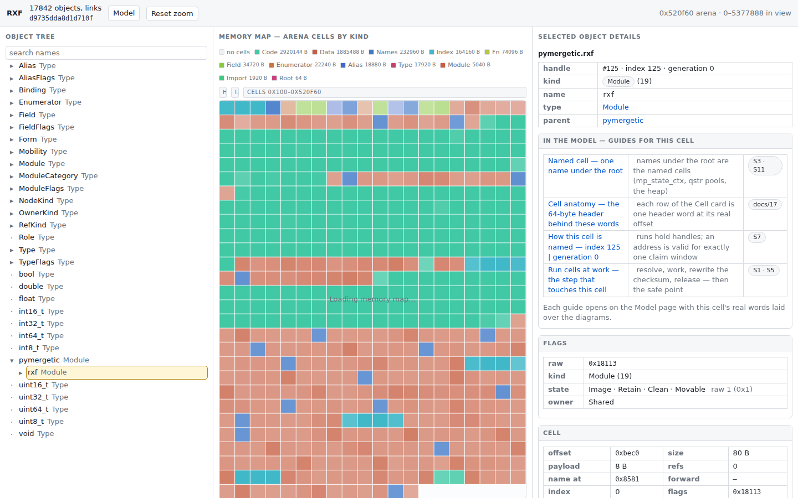
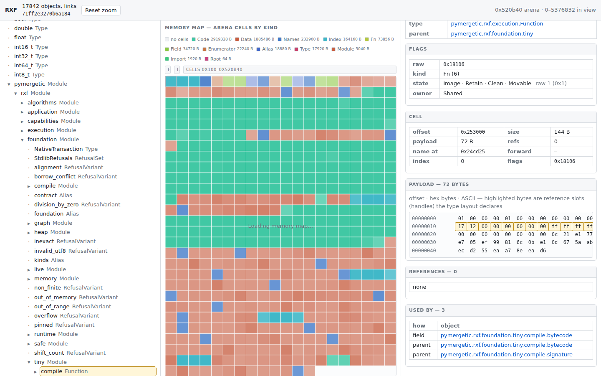

# RXF — Reversible eXecutable Format

RXF treats a program as a **complete, self-describing object world** rather than a
one-way compilation product. Types, modules, functions, calls, values, ownership,
semantic graphs, target descriptions, ABI contracts, and live data are ordinary
addressable objects in one binary image.

The same image can be:

- authored and stored as XML deltas, one file per module (paths and field values, no IDs);
- minted deterministically into one binary image and written back out unchanged;
- inspected as an object tree with fields, references, and who uses what; and
- digested twice: the image (compacted bytes) and the canonical text.

The direction (see [the operating-system path](17-OPERATING-SYSTEM-PATH.md)) is native
Code for several architectures inside the same image, and executable wrappers that keep **RXF
as the program** rather than a stripped binary with a metadata copy next to it.

**Status.** RXF is a new version: a C++ core on one arena, with Python as orchestration
(nanobind). What exists: the ground layout (`src/pymergetic/rxf/core/ground.h`, pinned for x86-64,
AArch64, i386, and wasm32 in C11 and C++20); the arena and the host image (paths, names, roles,
canonical copying compaction); the self-description (`Type` and `Field` objects read by one
generic codec); deltas as XML ([pugixml](https://pugixml.org)) with atomic replay on a journal, a link check,
and SHA-256 digests; a **live layer** that lets a running image be read and edited from outside
(CRC-framed channel, physical delta, compaction and relink in the image, safe points and break,
UART, shared-memory and pty providers, `rxf live`); a compiler leaf for every program (machine code on
three machines); the **self-editing path** ([19](19-SELF-EDITING-PATH.md)) under construction: the running
image compiles its own front end and replaces the compiler from a delta (the fixpoint run, proven on
x86-64, AArch64, and wasm32), and the in-image composer writes program words byte-identical to the host
composer for 52 of its 53 graphs; an image as a **module tree**, one XML file per module (`starter/`); the
`rxf` command line (Python Fire, command path = module path); a read-only inspector with an arena
memory map and cell introspection (see below); and the
build (CMake, scikit-build-core, nanobind 3, platform wheels through cibuildwheel). The compiler,
native Code binding, and executable builders of the former v5 Python stack are not in the tree
(its last state is the git tag `legacy-v5-python`) and are still to be rebuilt on the core
([what is missing](08-INVENTORY.md)). The package version stays `0.x` until then.

## Why

Conventional executable formats preserve enough information to load code, but usually
lose most of the program's authored structure. RXF is designed for systems where a
running or bootable artifact should still be explainable, transformable, movable, and
certifiable. The path of an object identifies it in every image and every delta, and
image-local `uint64` handles keep references compact while payloads and Code move;
signatures and target contracts make native binding explicit; copying compaction
produces deterministic successor images.

## Core invariants

([The operating-system path](17-OPERATING-SYSTEM-PATH.md), [the object model](01-OBJECT-MODEL.md).)

- the identity of an object is its path, unique per parent; handles are image-local `uint64` slots and never appear in a delta;
- the root, `Type`, and `Field` have the fixed handles 0, 1, and 2; every other object is found by path;
- one arena: an arena header, an index directory, and one cell stream (64-byte cell headers with inline 24-byte references, plus block cells for the index chunks and the names);
- everything with identity is an object, and `Type` and `Field` describe themselves; so is a reference's **role** (an object named by path, never a number);
- no DOMAIN semantic objects, arenas, regions, or per-domain heaps;
- ownership is a kind in the cell flags plus an optional `OWNER` reference, separate from lifecycle state;
- lifecycle is provenance × disposition × cleanliness × mobility;
- pages are allocator geometry and policy, not semantic objects;
- unknown limits never extend committed write authority; and
- deltas (XML) are the storage and exchange format, and successors are produced by deterministic, non-mutating copying compaction in path order.

## Architecture documentation

Read in order:

1. [Object model](01-OBJECT-MODEL.md)
2. [Allocator state](03-ALLOCATOR-STATE.md)
3. [References](04-REFERENCES.md)
4. [Semantic authority](05-SEMANTIC-AUTHORITY.md)
5. [Paths and views](06-PATHS-AND-VIEWS.md)
6. [Successor and activation](07-SUCCESSOR-AND-ACTIVATION.md)
7. [Current implementation inventory](08-INVENTORY.md)
8. [Operations and adapters](10-FACE-AND-CHANNELS.md)
9. [Bootstrap, verification, and trust](11-BOOTSTRAP-AND-QUORUM.md)
10. [Authoring](12-AUTHORING.md)
11. [Deltas, their XML form, and the module tree](15-DELTAS-AND-XML.md)
12. [Self-description](16-SELF-DESCRIPTION.md)
13. [Path to a self-contained operating system](17-OPERATING-SYSTEM-PATH.md)
14. [The native snippets: a multi-platform binary](18-NATIVE-SNIPPETS.md)
15. [The way to a self-editing image](19-SELF-EDITING-PATH.md)
16. [The execution policy: suspension is a data property](20-EXECUTION-POLICY.md)

These documents specify RXF independently of any runtime provider. The optional Metal binding
is described separately in [`integrations/metal.md`](integrations/metal.md).

## RXFB 6 binary model

An image is one arena: a 192-byte header, an index directory, and a cell stream. Object cells have a 64-byte header, the payload padded to 16 bytes, and 24-byte references (target, role, kind, binding, index); block cells carry the index chunks (4096 slots of 8 bytes) and the names. Identities, addresses, offsets, and sizes are 64-bit. The layout is defined once as C structs in `src/pymergetic/rxf/core/ground.h`, with the size and offset of every field pinned by static assertions. See [the arena and allocator state](03-ALLOCATOR-STATE.md).

## The module tree

The default image is checked in as `starter/`, one XML file per module, laid out like Python modules:

```
starter/__init__.xml                         the types and the entry
starter/pymergetic/__init__.xml              module pymergetic
starter/pymergetic/rxf/__init__.xml          module pymergetic.rxf
starter/pymergetic/rxf/kinds.xml            the enumerations of the data (AbiKind, Effects, ...)
starter/pymergetic/rxf/foundation/heap.xml  module pymergetic.rxf.foundation.heap
starter/pymergetic/rxf/roles/call.xml       module pymergetic.rxf.roles.call
```

```xml
<ABIValueLocation name="output" rxf:index="2" association="@heap.allocate.signature.value" ...>
  <rxf:ref role="@contract.IndirectPointee" kind="RefKind.Type" target="uint64_t" />
</ABIValueLocation>
```

Everything the format says itself is in the `rxf` XML namespace; an edge is said once (a field is the reference, the children are the list, the other direction is computed); roles are objects named by path; order among siblings is `rxf:index`; the n-th element of a list is `name[n]`; a word is the path of its enumerator (`kind="RefKind.Data"`, `layer="@kinds.FunctionLayer.Library"`), never a bare word or a number; a module may shorten long paths with aliases (`@call.Callee`); Types, enumerators, and roles are CamelCase, modules and fields snake_case. See [deltas and their XML form](15-DELTAS-AND-XML.md).

## Command line

`rxf` is one Python Fire entry point. A command lives next to what it operates on and its path is the module path: `core/object/cli.py` defines `rxf core object ...`, `server/cli.py` defines `rxf server ...`. A new `cli.py` is a new command group. `rxf` alone lists every command.

```sh
rxf core object info   starter                 # objects, entry, digests, problems
rxf core object check  starter                 # link check, exit status 1 on problems
rxf core object digest starter                 # image digest and delta digest
rxf core object save   starter starter.rxfb    # .xml one delta, .rxfb bytes, else a module tree
rxf core delta show    starter --module=pymergetic.rxf.roles
rxf core delta apply   starter patch.xml --to=out.rxfb
rxf server browse      starter                 # read-only inspector on http://127.0.0.1:8420
rxf console                                    # type .rxf; the running image compiles it
rxf console  program.rxf                       # one source file through the same path, once
rxf console  --inspect                         # what the image has installed (read-only)
```

A source is a module tree (directory), a `.xml` delta, or RXFB 6 bytes.

### Console

`rxf console` is the terminal on a running image: a program of `.rxf` ends at a blank line (or a
line of one `.`), travels as one object of the arena through the channel, and the image's own
front end (`native/front`) compiles it and has the Function installed — one delta, no restart.
The outcome is the path of the Function and its ids, or the line the front end stopped at.
`:list` shows what the image has installed, `:help` the words of the loop, `:quit` leaves.

```sh
rxf console --link=shm:rxf
rxf> program triple(x) {
...     return x + x + x;
...
installed pymergetic.rxf.selfedit.triple (id 0x4e1a69dd971cf5a3, 328 bytes)
rxf> :quit
```

`rxf console FILE` takes one source file through the same path once; the `.rxf` sources beside the
file (or beside the terminal) are what an `include` can name. `rxf console --inspect` only lists
what the image has installed. `--link` is where the running image is: `shm:name`, `pty:/dev/pts/3`,
`tty:/dev/ttyUSB0`, `fd:3`. A run is not a frame: whoever runs the image registers its machine
(`pymergetic.rxf.console.world.register`), and the console drives compile and install over the
live channel.

### Inspector

`rxf server browse` serves the read-only inspector: the object tree on the left, the arena
as a memory map in the middle (cells colored by kind, fill by payload occupancy — click
selects, double-click zooms, `Reset zoom` returns), and full cell introspection on the
right: decoded kind/state/owner flags, the cell fields, a payload hex dump, every
reference row with its role and target, and who points at the object.





## Layout

```
src/pymergetic/rxf/
  cli.py  source.py            the entry point and image I/O
  core/                        the compiled package pymergetic.rxf.core
    arena/ object/ hash/ meta/ delta/ xml/ tree/    C++ modules, each with bindings.cpp and, where it has a CLI, cli.py
    *.pyi                      generated stubs, one per Python submodule
  server/                      the inspector
```

## Develop

```sh
python -m venv .venv
.venv/bin/pip install scikit-build-core nanobind setuptools-scm
.venv/bin/pip install -e ".[test,server]" --no-build-isolation
.venv/bin/python -m pytest tests
.venv/bin/python tools/sanitize.py       # core tests under AddressSanitizer and UBSan
.venv/bin/python -m nanobind.stubgen -m pymergetic.rxf.core -r -q -O src/pymergetic/rxf
```

Rebuild with `pip install -e . --no-build-isolation` after every C++ change (and when a file is added: the editable install lists files). The inspector binds to `127.0.0.1` and is read-only.
